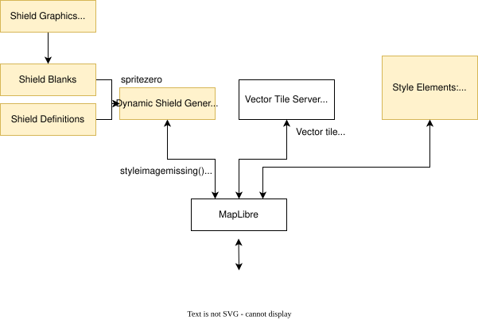

# Architecture

## Technology stack

The technology stack for this style can be summarized below:

The dynamic shield generator is included as a [module](shieldlib/README.md) in this repository and also [published to NPM](https://www.npmjs.com/package/@americana/maplibre-shield-generator).

Automatic label localization is powered by the [Diplomat](https://github.com/osm-americana/diplomat/) plugin, which is also [available on NPM](https://www.npmjs.com/package/@americana/diplomat).

## Structure

The repository is organized as follows:

- **src/** - The map style.
- **dev/** - Development tools used for style development. See [Style Developer Tools](dev/README.md).
- **test/** - Automated unit tests.
- **shieldlib/** - Maplibre [shield rendering library](shieldlib/README.md).

The style is located within **src/** and is organized as follows:

- **layer/** - Individual style layers, organized by subject area. The ordering of layers is specified in `index.js`.
- **constants/** - Style elements that are frequently re-used
- **icons/** - SVG icons, which get converted into PNG stylesheets
- **js/** - Dynamic javascript code for highway shields and stylesheet building
- **config.js** - Configuration settings (MapTiler API key, OpenMapTiles tile server URL, etc)
- **americana.js** - MapLibre loader and configuration for the demo map
- **index.html** - Demonstration map HTML page
