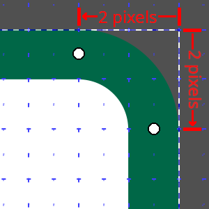
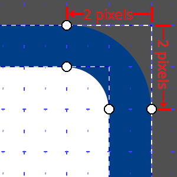

# Contributing

We’re glad you’re interested in contributing to OpenStreetMap Americana! Before you dive in, please take a moment to learn about:

- [This project’s architecture](ARCHITECTURE.md), including how this repository fits into the overall technology stack
- [How to install and run OSM Americana](INSTALL.md)

You can also help out indirectly by contributing to [our data sources](ACKNOWLEDGMENTS.md#data-sources).

## Ground rules

Some general guidelines:

- All contributors are subject to the [code of conduct](CODE_OF_CONDUCT.md).
- Please follow the coding style guidelines described in each sub-folder. These guidelines are designed to make it easier for collaboration and reduce the chance of edit conflicts.
- Innovation is encouraged! Please open a new ticket with your great ideas as a centralized focal point for discussion.
- New contributors are welcome!
- This style operates on the principle of consensus. Maintainers should ensure that changes represent a broad consensus within the American mapping community.
- Maintainers are also responsible to ensure that this principle of consensus does not cause stagnation or inaction. Contributor time is valuable; accepting the responsibility of being a maintainer means committing to responding to issues and PRs on a reasonable timeline that encourages community participation.

## Before submitting a PR

1. Please prettify all files prior to submission. Run `npm run code_format` to
   format code files with [prettier][90] and SVG files with [SVGO][svgo].
2. If you are introducing a new kind of feature to the style, add a section to
   `src/js/legend_config.js` or a legend entry in the corresponding file in
   `src/layer/` that tells the Legend control how to find and render a
   representative feature. Also try out the Samples button to catch any visual
   conflicts.
3. If you are introducing a novel approach to depicting a layer or feature
   property from the OpenMapTiles schema, document how the corresponding
   OpenStreetMap key or tag is used in `scripts/taginfo_template.json`.
4. If any shield background icons are introduced, add lines to `src/shieldtest.js`
   to demonstrate overlaid text on each of them.
5. If you are introducing new JavaScript code that can run independently of a
   browser environment, add automated unit tests for it to `test/spec/`, then
   run `npm test` to ensure that they pass. This project structures unit tests
   using [Chai](https://www.chaijs.com/guide/styles/) for assertions.
6. There are built-in GitHub actions that will generate a preview map of your
   changes. We recommend initially creating a PR draft, and then using the preview
   map to capture links and screenshots to add to your PR. To access the map,
   expand the "checks" section at the bottom of the PR, and click on "PR Preview"

[90]: https://prettier.io/
[svgo]: https://github.com/svg/svgo/

### Style complexity checks

When adding or changing style layer code, it can be helpful to assess the change in size and complexity. In general, higher layer counts and higher layer size have a negative impact in performance. Contributors should attempt to consolidate layers when possible.

There is a "stats" script that will generate various statistics about layer composition and complexity:

- `npm run -s stats -- -a -s` - overall size and breakdown of layers
- `npm run -s stats -- -c` - total layer count
- `npm run -s stats -- -h` - list all options

There is an "extract_layers" script that will extract layer style data:

- `npm run -s extract_layer -pl <layer>` - JSON contents of a specified layer
- `npm run -s extract_layer -pg <source>` - list of layers from a specified source
- `npm run -s extract_layer -h` - list all options

## Layers

1. Layers must be uniquely named.
2. For performance reasons, it is better to have fewer layers with filters than multiple, simpler layers.
3. Layers are drawn in the order specified in `layer/index.js` using the [Painter's Algorithm](https://en.wikipedia.org/wiki/Painter%27s_algorithm).

To see layer statistics, run `npm run stats` to get a list of options.

## Highway Shield Contributor's Guide

Highway shields are a key feature of the OpenStreetMap Americana style. This guide describes some of the style principles that contributors of highway shield artwork should consider when submitting new shields. The required elements are as follows:

1. Shields are in .svg format
2. Shields are 20px on the smallest dimension (this will be rasterized to 20px or 40px depending on display resolution)
3. Shields are license-compatible (public domain or CC0)

In addition, the following style guidelines are recommended:

1. Use a 1px stroke size for line elements. Horizontal/vertical lines should be aligned to the pixel grid.
   - In Inkscape, press `Ctrl+Shift+D`, and create a rectangular grid in the "Grids" tab. Set Spacing X and Spacing Y to `0.5`, and Major grid line every `2`. You can turn snapping to the grid on and off by pressing `%`.
2. Complex or intricate graphic elements should be simplified.
3. Background shading should be removed.
4. Route numbers should be large enough to be legible.
5. Shields should consistently use squared or rounded corners, but not a mix of both. Rounded corners should have a 2px radius.
   - To give a rectangle a 2px corner radius, drag the circular handles 2 pixels (4 grid lines) away from the edge, as shown in the following examples:

 

In general, this style is not trying to exactly replicate highway shields as seen on signage. Instead, we are trying to extract the key stylistic elements so that the graphics are recognizable as simplifications of their real-world counterparts. Here are some examples of Americana's simplified shields for small-size readability:

| Network                | Real-world Shield                                                                                          | Americana Representation                                  |
| ---------------------- | ---------------------------------------------------------------------------------------------------------- | --------------------------------------------------------- |
| NJ Turnpike            |  |  |
| Washington State Route |                    |             |

More complicated shields may be more challenging to simplify. Consider taking some inspiration from the [rebusurance](https://github.com/1ec5/rebusurance) project, which effectivly simplifies a number of complex state shield designs by stretching, compressing, omitting, or simplifying graphic elements.

### Color Scheme

For consistency, most shields should use the following color palette, which is based on the national _Manual of Uniform Traffic Control Devices_:[^mutcd-color-specs]

| Color                                           | Pantone | RGB         | Hex triplet |
| ----------------------------------------------- | ------- | ----------- | ----------- |
| $`{\color{#003f87} \blacksquare}`$ Blue         | 294     | 0 63 135    | #003f87     |
| $`{\color{#693f23} \blacksquare}`$ Brown        | 469     | 105 63 35   | #693f23     |
| $`{\color{#006747} \blacksquare}`$ Green        | 342     | 0 103 71    | #006747     |
| $`{\color{#f38f00} \blacksquare}`$ Orange       | 152     | 243 143 0   | #f38f00     |
| $`{\color{#df4661} \blacksquare}`$ Pink         | 198     | 223 70 97   | #df4661     |
| $`{\color{#6d2077} \blacksquare}`$ Purple       | 259     | 109 32 119  | #6d2077     |
| $`{\color{#bf2033} \blacksquare}`$ Red          | 187     | 191 32 51   | #bf2033     |
| $`{\color{#ffcd00} \blacksquare}`$ Yellow       | 116     | 255 205 0   | #ffcd00     |
| $`{\color{#c4d600} \blacksquare}`$ Yellow-green | 382     | 196 214 0   | #c4d600     |
| $`{\color{#ffffff} \blacksquare}`$ White        | N/A     | 255 255 255 | #ffffff     |
| $`{\color{#000000} \blacksquare}`$ Black        | N/A     | 0 0 0       | #000000     |

[^mutcd-color-specs]: [MUTCD Color Specifications](https://mutcd.fhwa.dot.gov/kno-colorspec.htm), Federal Highway Administration

The MUTCD’s standard colors are designed for high-contrast backgrounds and legends. This is also advantageous on a map where shields need to stand out a variety of lines and fills. However, tourist and scenic route shield often depict natural scenes in a photorealistic style, requiring some tints that stand out against the usual background shades. These shields can take advantage of additional colors for contrast and recognizability, including:[^caltrans-sign-specs]

| Color and example usage                                    | Pantone | RGB         | Hex triplet |
| ---------------------------------------------------------- | ------- | ----------- | ----------- |
| $`{\color{#ddcba4} \blacksquare}`$ Cream/tan (wood)        | 468     | 221 203 164 | #ddcba4     |
| $`{\color{#9bcbeb} \blacksquare}`$ Light blue (sky, water) | 291     | 155 203 235 | #9bcbeb     |
| $`{\color{#6cc24a} \blacksquare}`$ Light green (foliage)   | 360     | 108 194 74  | #6cc24a     |

[^caltrans-sign-specs]: [California Sign Specification Drawings](https://dot.ca.gov/programs/safety-programs/sign-specs), California Department of Transportation

See the [developer tools](dev/README.md) for an importable, Inkscape-compatible palette file.

### Icon Grid Alignment

There is a utility script called icon_grid that will generate a pixel grid on an SVG. This can be used to check how well the icon will align to the pixel grid. Run this utility as follows:

`npm run icon_grid -- icons/poi_fuel.svg`

### Font Sizes

Shields should target 8-14px text actual-size character heights for readability:

| Example                                                 | Text height |
| ------------------------------------------------------- | ----------- |
|  | 16px        |
|  | 14px        |
|  | 12px        |
|  | 10px        |
|   | 8px         |
|   | 6px         |

It is not possible to use font sizes greater than 14px in shields.

### Shield Definitions

The `loadShields` function in js/shield_defs.js contains a definition object for each shield displayed on the map. A definition object can contain the following properties:

- **`spriteBlank`** – A reference to the image file used as the shield background, based on the name of the file in icons/. To use a different image depending on the length of the inscribed text, specify an array of images.
- **`colorLighten`** – Replace the black portions of the specified background image with this color via a "lighten" operation.
- **`colorDarken`** – Replace the white portions of the specified background image with this color via a "darken" operation.
- **`numberingSystem`** – If the shield should express the route number in Roman numerals for stylistic reasons, even though the same route number is normally expressed in (Western) Arabic numerals in other contexts, set this property to `roman` to automatically convert the `ref` to Roman numerals.
- **`noref`** – An alternate shield definition to use when there is no `ref`. This is appropriate if some routes in the network have a `ref` tag and others do not, and the routes with no ref need a special shield.
- **`notext`** – By default, a relation missing a `ref` tag will not appear as a shield. Set this property to `true` to display a shield even if it has no `ref`. This is appropriate for one-off shield networks, which are common for toll roads and touristic routes.
- **`padding`** – An object that specifies the amount of padding on each side of the inscribed text relative to the background image.
- **`textColor`** – The color of the inscribed text to superimpose on the background.
- **`textHaloColor`** – The color of the halo surrounding the inscribed text.
- **`textLayoutConstraint`** – A strategy for constraining the text within the background image, useful for shields of certain shapes. By default, the text will expand to fill a rectangle bounded by the specified padding while maintaining the same aspect ratio.
- **`verticalReflect`** – Set this property to `true` to draw the shield image upside-down.

In addition to `textHaloColor`, the config variable **`SHIELD_TEXT_HALO_COLOR_OVERRIDE`** can be used to override the text halo color on all shields. This can be helpful to avoid collisions with other design features when determining padding values. For example, set `SHIELD_TEXT_HALO_COLOR_OVERRIDE` in src/config.js to `"magenta"` to display a magenta halo around all shield text.

If special code is necessary to style a route with a specific `ref` or `name` in a particular network, **`overrideByRef`** or **`overrideByName`** can be used to define and override any of the above properties. `overrideByRef` is an object mapping `ref` values to partial shield definition objects, containing whichever properties are to be overridden for that particular `ref` value. `overrideByName` does the same for `name` values. If necessary, these parameters can be used to override the entire shield definition.

Additionally, **`refsByName`** is an object mapping way names to text that can be superimposed on the background as a fallback for a missing `ref` value. (`refsByName` implies `notext`.) This temporary fallback is designed for use in [limited situations](https://wiki.openstreetmap.org/wiki/United_States/Unusual_highway_networks). In the future, it is expected that these initialisms will be encoded on the server side by processing appropriate tagging which holds the initialism in the database.

`refsByName` only works if there is no `ref` tag and the expression in the `routeConcurrency` function in layer/highway_shield.js includes the `name` property in the image name. The network needs to be listed as an input value that causes the `match` expression to append `name` to the image name.

When using `overrideByRef` or `refsByName`, make sure to add a line to the Special Cases section of this page explaining why it is necessary, as they are only intended for use in special cases.

In the case where all routes in a network should be drawn with the same shield text, set the text value in `ref`.

### Banners

The shield definition supports a property **`banners`** which accepts an array of text strings which will be drawn atop each shield, in 10px height increments. This is used in cases where additional text is needed to differentiate shields with a common symbology, for example for [special routes of the US Numbered Highway System](https://en.wikipedia.org/wiki/List_of_special_routes_of_the_United_States_Numbered_Highway_System):

 

Banners should be specified in the following cases:

- When a route represents a variant of a main route with which it shares a common shield design. The banner ensures that the variant route information, which is an important component of the route, is visually displayed.
- When two or more routes from different networks share a common symbology in the map within a common geographical area. Shields which are very similar may be drawn using common graphics for simplicity and readability, for example, when the networks differ only by a difference in text. In these cases, the most significant network should be drawn with no banner, and each of the less significant networks should be drawn with a banner.
- When a short text of up to 4 characters is a significant stylistic element of a shield that can't reasonably be incorporated into the main shield graphic for aesthetic reasons.

In all cases, banner text should be no more than **4** characters in length.

### Special Cases

This style strives to draw representative highway shields wherever they are tagged on road route relations consistently with international norms. This style operates on the expectation that the `network` value on a route relation corresponds to the shield design that will be drawn, and the `ref` value will contain the text which is drawn on the shield. In order to give appropriate mapper feedback, this style will add support for special cases only when the complexity of the route network and shield styling cannot be adequately expressed via `network` and `ref` alone. These special cases should be exceptionally rare and documented in the list below. PRs to add special case code should also add an entry below justifying its inclusion. For all other `network` and `ref` combinations, the style will draw a "generic" shield displaying the `ref` value.

- Shields of individual routes that have unique design elements while sharing an overall theme. Such cases include:
  - **Great Lakes Circle Tour**. Each shield shows a ribbon encircling another graphic representing one of the Great Lakes.
- Shields of individual routes having a special color scheme (and possibly additional artwork or text omitted for the purposes of this project), but otherwise matching the shape of shields for the rest of the network. Such cases include:
  - **Arkansas Highway 980**. Highway 980 is a designation applied to various short state highways leading to airports. It has a unique shield based on the state route shield, with a white-on-blue color scheme and additional artwork.
  - **Georgia State Routes 515 and 520**. Highway shields for Georgia State Routes 515 and 520 are colored in blue and green respectively, rather than the usual black, for their entire length. This is done because these roads are part of the Governor's Road Improvement Program (GRIP).
  - **Michigan Highway M-185**. M-185 has a special shield based on the State Trunkline Highway shield, with a white-on-brown color scheme and additional text.
  - **Ontario's Queen Elizabeth Way**. The Queen Elizabeth Way has a special shield based on the King's Highway shield, with a blue-on-yellow color scheme.
  - **Yukon Routes**. The majority of Yukon Route shields are red, but certain numbered highways have yellow, blue or green shields for their entire length. All shields have a simple square shape.
- Shields for route networks where the full name of the route is displayed unabbreviated in real life, but abbreviated for the purposes of this project. Such cases include:
  - **Houston, TX toll roads**. Harris and Fort Bend Counties each sign a network of toll roads which use a common shield styling, but with full-text names of the highways on the shields. Because these counties' toll road systems are clearly common networks due to their common shield symbology, special code is needed to convert toll road names to their locally-expected initialisms. Because the initialisms are not present on shields, it would not be appropriate to encode this data in the `ref` tag.
  - **Kentucky Parkways**. Kentucky signs a network of state highways which use a common shield styling, but with full-text names of the parkways on the shields. In addition, these routes are locally known by initialisms. Because these parkways are clearly a common network due to their common shield symbology, special code is needed to convert parkway names to their locally-expected initialisms. Because the initialisms are not present on shields, it would not be appropriate to encode this data in the `ref` tag.
  - **New York Parkways**. The State of New York signs a network of highways which use a common shield styling, but with full-text names of the parkways on the shields. The first letter of each word in a parkway's name is capitalized and in a larger font, making initialisms easily recognizable. Because these parkways are clearly a common network due to their common shield symbology, special code is needed to convert parkway names to their initialisms. Because the initialisms are present on shields, but only as part of the full name, it would not be appropriate to encode this data in the `ref` tag.
  - **Connecticut Parkways**. Connecticut has several state-designated parkways that share the `network=US:CT:Parkway` tag but have no parkway-specific `ref` tags. The Merritt Parkway is the only of these to be signed with a route shield. Special code is needed to differentiate the Merritt from the state's other parkways.
  - **New Hampshire Turnpikes**. New Hampshire has three named turnpikes without unique `ref=` values. One turnpike is unsigned, while the other two use a shield with the full name of the turnpike and a color for each turnpike.
- Shields for route networks where each individual route is identified by a color, rather than a number or letter. Such cases include:
  - **Allegheny County, PA Belt Routes**. Shields for this system use colors, with a colored circle and the words "<COLOR> BELT". These shields are drawn as squares with colored circles, with the `ref` values correctly corresponding to the text on the shield. Because of the common design (white shield with colored circle), these shields are properly part of a common route network. Special code is needed to convert the textual ref values to the colors displayed in the shield.
  - **Branson, MO color-coded routes**. Shields for this system use colors, with a colored rectangle and the words "<COLOR> ROUTE". These shields are drawn as squares with colored rectangles, with the `ref` values correctly corresponding to the text on the shield. Because of the common design (green shield with colored rectangle), these shields are properly part of a common route network. Special code is needed to convert the textual ref values to the colors displayed in the shield.
- Shields with a stacked ref configuration, with `/` separating the two lines of text in the `ref` value. Currently, these `ref` values are displayed verbatim on one line, and the code necessary for stacked ref rendering has not been written yet ([#366](https://github.com/osm-americana/openstreetmap-americana/issues/366)). Such cases include:
  - **Italy "Diramazione" (branch) motorways**. Between their main autostrade "A" roads, the Italian motorway network has branch motorways which carry the name of both highways that they connect. For example, the A7 and A26 motorways have a branch motorway named A7/A26, which is correctly tagged `ref=A7/A26` and shown on shields with the two numbers stacked vertically.
  - **West Virginia County Routes**. The West Virginia Department of Transportation posts County Routes, which can have shields with two stacked numbers. For example, in Mercer County, County Route 460/1 is a branch off U.S. Route 460, and County Route 27/6 is a branch off County Route 27. These routes are correctly tagged `ref=460/1` and `ref=27/6` respectively, and shown on shields with the two numbers stacked vertically.
- The [highway classification system of the United Kingdom](https://wiki.openstreetmap.org/wiki/Roads_in_the_United_Kingdom). In the UK, mappers need to and are able to tag the actual official road classifications independently of route networks. The color and style of route signage is based on a strict 1:1 correspondence with the `highway=*` value of the underlying road, and **not** based on M/A/B highway network type. While "M" roads are always motorways with blue route symbology, "A" roads can anything from primary through motorway, and thus may take one of three colors and may change along a single route. Even if mappers were to create route relations containing all roads with the same route number, these relations would not be usable for determining how to render route symbology. Additionally, there are no route concurrencies in the UK; all roads that are `highway=secondary` or higher carry a single `ref` value that can be directly rendered into a shield without pre-processing. There is established data consumers support for this highway classification-based symbology system, most notably OpenMapTiles, which has provided pseudo-network values for UK routes since the project's inception. Therefore, this project consumes the UK pseudo-network scheme established by OpenMapTiles and colors UK route network symbology strictly based on `highway=<motorway/trunk/primary/secondary>` consistent with UK signage.

### Shield Test Gallery

For testing out changes across a variety of different shield designs and ref lengths there is a shield test gallery available:

- In local development: http://localhost:1776/shieldtest.html
- On the public demo site: https://americanamap.org/shieldtest.html

This aims to display a table of all the unique shield designs in the style with some example refs from 1 to 6 characters. The `networks` and `refs` arrays can be modified for testing with a different set of either:

https://github.com/osm-americana/openstreetmap-americana/blob/581e1e5d97f5745c1bf764689439d93403888505/src/shieldtest.js#L16-L31
https://github.com/osm-americana/openstreetmap-americana/blob/581e1e5d97f5745c1bf764689439d93403888505/src/shieldtest.js#L203-L218

To test with a list of all the supported networks in the style this line can be uncommented:

https://github.com/osm-americana/openstreetmap-americana/blob/581e1e5d97f5745c1bf764689439d93403888505/src/shieldtest.js#L200-L201

This results in a very long page and can be quite slow or even crash the browser tab.

## Points of Interest

A "point of interest" or POI is any feature on the map represented by an icon on the map. To add a new POI:

1. Identify the `subclass` of the POI you are adding from the [OpenMapTiles schema](https://openmaptiles.org/schema/#poi).
2. Place the (.svg) icon file under [/icons](/icons) using the `poi_` prefix. Icons should have a black fill and may have a 1px white halo. Icons should be maximum 20x20 pixels, and pixel-aligned (snapped to a 1px grid) if the shape permits. Icons depicting small-scale features may be smaller than 20x20px.
3. In [poi.js](/src/layer/poi.js), add an entry to `iconDefs` with the `subclass`, sprite name, color category (see below), and legend description. Also update the `paint` and `filter` statements with the new `subclass`, choosing the earliest (furthest-out) zoom the icon can appear at appropriately.

### Categories

POIs are broken down into the following broad categories, in order to constrain the number of colors shown on the map. Some features may not cleanly fit into one category or another. Contributors should consider other POIs in the category to determine which category is the best fit.

- **Geographic Place Names**: labels associated with `place=` tags, for countries, cities, locations, etc.
- **Infrastructure**: features associated with public infrastructure, health, safety, or government.
- **Consumer**: businesses that provide services to the public, such as shops and restaurants.
- **Outdoor**: parks, nature reserves, and other outdoorsy features.
- **Attraction**: places where people go for entertainment, leisure, or curiosity.
- **Transport**: places where people can access forms of transportation, such as airports, train stations, bus stops, and other public transit.

### Color Scheme

For consistency, POI icons use the following color palette:

| Category               | Scheme          | Color                                                | RGB         | Hex triplet |
| ---------------------- | --------------- | ---------------------------------------------------- | ----------- | ----------- |
| Geographic Place Names | N/A             | $`{\color{#000000} \blacksquare}`$ Black             | 0 0 0       | #000000     |
| Infrastructure         | Pantone 294     | $`{\color{#003f87} \blacksquare}`$ Blue              | 0 63 135    | #003f87     |
| Consumer               | UTexas Orange   | $`{\color{#bf5700} \blacksquare}`$ Orange            | 191 87 0    | #bf5700     |
| Outdoor                | Pantone 342     | $`{\color{#006747} \blacksquare}`$ Green             | 0 103 71    | #006747     |
| Attraction             | Pantone 469     | $`{\color{#693f23} \blacksquare}`$ Brown             | 105 63 35   | #693f23     |
| Airport                | Medium Purple C | $`{\color{#4e008e} \blacksquare}`$ Purple            | 78 0 142    | #4e008e     |
| Transport              | Pantone 234 C   | $`{\color{#a20067} \blacksquare}`$ Mauve             | 162 0 103   | #a20067     |
| Knockout               |                 | $`{\color{#f9f5f0} \blacksquare}`$ Lt Grayish Orange | 249 245 240 | #f9f5f0     |

## Labels

Fonts for style labels are packaged and defined in [fontstack66](https://github.com/osm-americana/fontstack66), Americana's font package. For some icons, it may be stylistically advantageous to show the icon at an earlier zoom level than the label.

## Render Samples

A GitHub action will check a list of regression test locations to see if the map has changed. If any of those locations have changed visually, the "Map Preview" check will generate before and after images. If your PR changes the visual appearance of the map, add an entry to `test/sample_locations.json` with a location that best illustrates the change. This will help show your change to PR reviewers as well as act as a regression test for future PRs.
