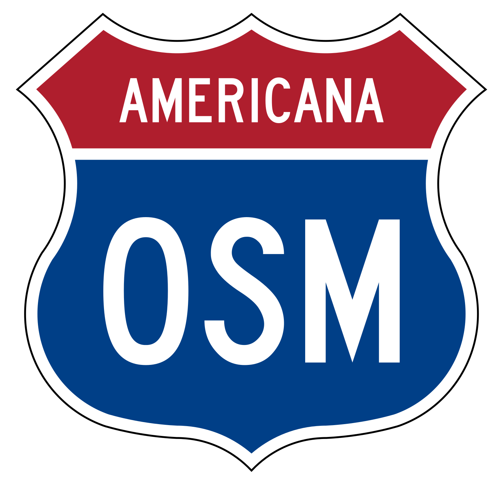
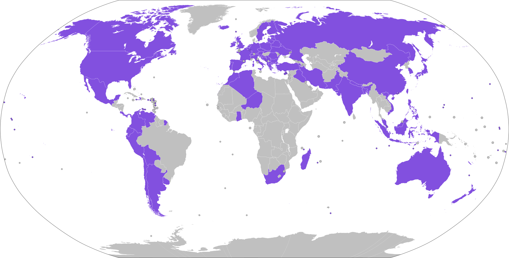

# OpenStreetMap Americana

_A quintessentially American map style_ [🗺 View the map](https://americanamap.org/)

> _The United States of America is such a glorious mess of contradiction, such a crazy quilt of competing themes, such a fecund mishmash of people and ideas, that defining us is pretty much pointless. There is, of course, a kind of faded notion of "Americana", one that concerns Route 66, diners, freak rock formations, and the like—but even in its halcyon days this "roadside attraction" version of America was never an accurate or nuanced distillation of our massively complicated culture._  -Hampton Sides, <i>[Americana: Dispatches from the New Frontier](<https://en.wikipedia.org/wiki/Americana_(Sides_book)>)</i> (2004)

## Introduction

[OpenStreetMap](https://www.openstreetmap.org/) is the world’s largest open data project about geography. OSM works together as a community to document the world all the way down to the level of an individual door or tree. Technically speaking, OpenStreetMap Americana is a visually distinctive “style” or “renderer” for exploring that data, with personalization features powered by vector tile technology. You can think of it like the old map in your glove compartment, but it learned some new tricks from the digital world.

OSM Americana [takes inspiration](https://openstreetmap.us/events/state-of-the-map-us/2023/best-of-both-worlds-designing-an-international-american-map/) from the typical transportation maps and atlases that are printed in North America. The conventions among these maps are familiar to Americans while departing from the norms in Europe and online. We’ve demonstrated or pioneered several cartographic techniques of importance to Americans that we hope will someday become commonplace among OpenStreetMap-based map styles:

- Nuanced line styles help you distinguish roads, raiload tracks, and waterways based on a variety of intuitive characteristics.
- Highway routes are identified by shields that resemble the signs on the road, with special support for roads that carry multiple routes concurrently.
- Place labels throughout the world appear in both your preferred language and the local language, reflecting linguistic diversity both in the U.S. and abroad.
- A dynamic legend communicates these design choices intuitively, regardless of the visual language you’re accustomed to.

OSM Americana is a continual work in progress. We support [thousands of OSM tags](https://taginfo.openstreetmap.org/projects/osm_americana#tags) ([source](https://americanamap.org/taginfo.json)), but this is only the tip of the iceberg of what we plan to support someday as part of a coherent, usable map.

_OSM Americana includes hundreds of distinctive route shield designs, on top of more basic designs that are common to highway systems throughout the world._

## Why Americana?

No map is universal. Every mapmaker makes editorial and design choices that reflect their lived experiences and worldview, furthering their goals within practical limitations.

For many years, OSM’s U.S.-based mapper community coped with standard renderers that either catered to European tastes or uncritically adhered to the design choices in early GPS units. As American mappers, we expected functionality and distinctions that these projects were unprepared to prioritize. We needed [route shields](https://media.ccc.de/v/sotm2022-21683-0-lightning-talks-v#t=669), expressways, and more just to be able to use the map we were building, let alone share it proudly with our friends and neighbors. We also wanted a space to experiment more freely without the burden of being a singular representation of OSM. So as a community, we created OSM Americana as complement to existing projects that answers these needs.

As an integral part of OSM’s U.S.-based community of mappers and software developers, OSM Americana seeks to:

- Promote collaboration and common purpose in OSM’s U.S. community.
- Express the American experience through cartography.
- Challenge the status quo by showcasing innovation and invention.

We are excited to see other local communities also take up the challenge to make a map that suits their needs, and we look forward to learning from their efforts.

## Explore Americana

The interactive map is available at [americanamap.org](https://americanamap.org/). Click the Legend button to learn the meaning of each symbol, line, and color based on the features currently visible on the map. Click the 🌐 button to simulate a physical globe. Click the ⛰️ button to simulate a relief map.

The style tries to label places in [your browser’s preferred language](https://www.w3.org/International/questions/qa-lang-priorities). To change this preference, consult your browser’s documentation: [Chrome](https://support.google.com/chrome/answer/173424), [Firefox](https://support.mozilla.org/en-US/kb/use-firefox-another-language), [Safari for macOS](https://support.apple.com/guide/mac-help/change-the-system-language-mh26684/mac), [Safari for iOS](https://support.apple.com/en-us/HT204031). To override this preference, click the Change button in the lower-right corner of the map. Alternatively, add `&language=` to the URL, followed by a comma-separated list of [IETF language tags](https://www.w3.org/International/articles/language-tags/). For example, here’s a map labeled [in Portuguese, falling back to Spanish](https://americanamap.org/#language=pt,es). If we don’t have the name of a place in any of your preferred languages, the style shows the name in the local language as a last resort.

## Bring a slice home with you

You can [build and deploy OSM Americana](INSTALL.md#production-builds) anywhere as static Web page or integrate it into your own Web application via an NPM package. If your project has specific needs that do not apply more generally to this project’s audience, feel free to fork this repository.

OSM Americana is a Web application that generates a [MapLibre stylesheet](https://maplibre.org/maplibre-style-spec/) at runtime. Many Web and mobile software applications can display MapLibre stylesheets. You can point these applications to [this prebuilt stylesheet](https://americanamap.org/style.json) in JSON format, with the following caveats:

- Route shields and some point of interest icons are missing.
- Labels are in the local language and units, not your preferred language and units.

The same caveats apply if you set up a simple MapLibre map using this JSON file. For the full OSM Americana experience, install the following MapLibre plugins:

- [Americana Shield Renderer](shieldlib/README.md) ([@americana/maplibre-shield-generator](https://www.npmjs.com/package/@americana/maplibre-shield-generator)) for route shields. [Shield definitions](https://americanamap.org/shields.json) are available for typical maps.
- [Diplomat](https://github.com/osm-americana/diplomat/) ([@americana/diplomat](https://www.npmjs.com/package/@americana/diplomat)) for localized labels.

These plugins are compatible with any MapLibre style. Install them on your Web page to lend your map an Americana level of sophistication.

The map’s contents come from tiles that conform to the [OpenMapTiles schema](https://openmaptiles.org/schema/). The default configuration uses tiles hosted by the [OpenStreetMap U.S. Tileservice](https://tiles.openstreetmap.us/vector/openmaptiles/). The [tile server usage policy](https://tiles.openstreetmap.us/usage-policy/) describes the allowable usage of this tileset. Compatible tilesets are also available from several commercial hosts. Alternatively, you can [set up your own tile server](INSTALL.md#running-your-own-tile-server) on cloud infrastructure at relatively modest cost.

## It takes a village

Come join our barn raising! OSM Americana is a hands-on opportunity to learn more about maps than you can simply as an armchair mapper or Web developer. Bring your map collection and help us identify elements of print cartography that can be driven by OSM data. Help us investigate any changes that our dependencies need to make to implement these features. Let us know about any highway route system that lacks representation on the map. Try your hand at implementing a route shield.

To learn more about contributing, see our [contributing guide](CONTRIBUTING.md). You can also help out indirectly by contributing to [our data sources](ACKNOWLEDGEMENTS.md#data-sources).

## Coverage

Americana is compatible with vector tiles covering the entire world.

Americana displays custom route shields for routes in all U.S. states and territories, and for routes in the following countries:

We are hoping that it will support more countries; you can [help us](https://github.com/osm-americana/openstreetmap-americana/projects/1)!

## Acknowledgments

[OpenStreetMap U.S.](https://openstreetmap.us/), OpenStreetMap’s local chapter in the United States, supports OSM Americana as a community project by providing tile rendering and other computing infrastructure. You can support the work we do by [donating to OpenStreetMap U.S.](https://openstreetmap.us/get-involved/donate/)

The source code and artwork in this repository are [dedicated to the public domain](LICENSE) under a CC0 waiver. Some icons incidentally depict logos or insignia that may be subject to trademark restrictions when used outside the context of a map. See the [full acknowledgments](ACKNOWLEDGEMENTS.md).
